# Topologia KNX TP

Jak zbudowana jest instalacja KNX na skrętce (TP): segment linii, linia, obszar i sieć wielu obszarów, rola sprzęgieł, adres indywidualny, przepływ telegramów oraz zastępowanie sprzęgieł routerami KNXnet/IP.

!!! abstract "Źródło"

    Opracowanie rozdziału **„Topologia KNX”** z materiałów szkoleniowych KNX Association, *Basic course* (plik `4_Topology_PL1025b.pdf`). Tekst i rysunki pochodzą z tego materiału; poprawiono literówki i ułożono treść pod portal.

!!! info "Oznaczenie [E]"

    Sekcje oznaczone etykietą **[E]** zawierają informacje wymagane także na kursie **KNX NextGen**. Pozostałe mają charakter informacyjny. Materiał dotyczy trybu konfiguracji **S-Mode** (tryb systemowy, ETS); dawny E-Mode nie jest omawiany.

**Skróty używane w rozdziale**

| Skrót | Znaczenie |
| --- | --- |
| BC | sprzęgło obszarowe (szkieletowe) |
| LC | sprzęgło liniowe |
| DVC | urządzenie magistralne |
| LR | wzmacniacz liniowy |
| PS | zasilacz z dławikiem |
| S | czujnik jasności |
| HC | licznik przejść (dawniej licznik kontroli przejść, RC) |
| SC | sprzęgło segmentowe |

## Ogólny widok topologii TP [E]

<figure markdown="span">
  [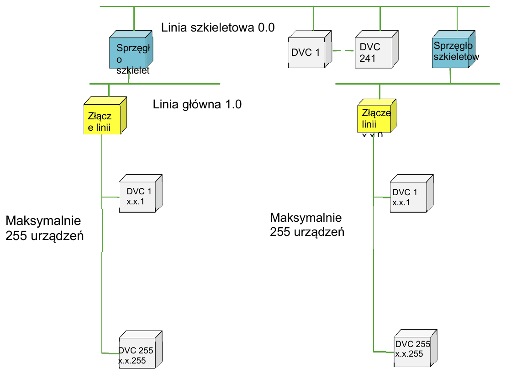{ loading=lazy }](../assets/img/topologia/rys01-ogolny-widok-tp.png)
  <figcaption>Rysunek 1: Maksymalny rozmiar topologiczny instalacji KNX TP</figcaption>
</figure>

Rysunek pokazuje maksymalny rozmiar instalacji KNX TP. Kolejne sekcje rozkładają go na części. Dwa pojęcia wracają w całym kursie:

**Linia nadrzędna (strona „północna”)** to górny segment sprzęgła liniowego lub obszarowego. Zależy od typu sprzęgła:

- dla sprzęgła liniowego linią nadrzędną jest linia główna TP,
- dla routera IP linią nadrzędną jest strona IP.

**Linia podrzędna (strona „południowa”)**, nazywana też linią wtórną, to dolny segment sprzęgła:

- dla sprzęgła liniowego jest to linia TP,
- dla routera IP jest to strona TP.

## Segment linii [E]

<figure markdown="span">
  [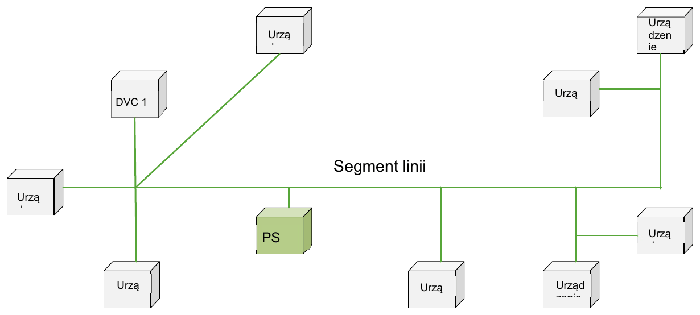{ loading=lazy }](../assets/img/topologia/rys02-segment-linii.png)
  <figcaption>Rysunek 2: Topologia, segment linii</figcaption>
</figure>

Segment linii to najmniejsza jednostka topologii KNX TP:

- maksymalnie **256 urządzeń** na segment linii,
- urządzenia wymieniają telegramy z dowolnym innym urządzeniem w tym samym segmencie,
- każdy segment linii wymaga **własnego zasilacza**,
- rzeczywista liczba urządzeń zależy od dobranego zasilacza i poboru prądu poszczególnych urządzeń.

**Dozwolone struktury okablowania.** Kabel magistrali można rozgałęziać w dowolnym miejscu:

- **gwiazda**: urządzenia połączone promieniście,
- **linia (łańcuch)**: urządzenia połączone jedno za drugim,
- **drzewo**: połączenie gwiazdy i linii, najoszczędniejsze w okablowaniu.

!!! danger "Pętle i pierścienie są niedozwolone"

    Zamknięta pętla kabla magistrali powoduje konflikty w sieci.

## Obszar

<figure markdown="span">
  [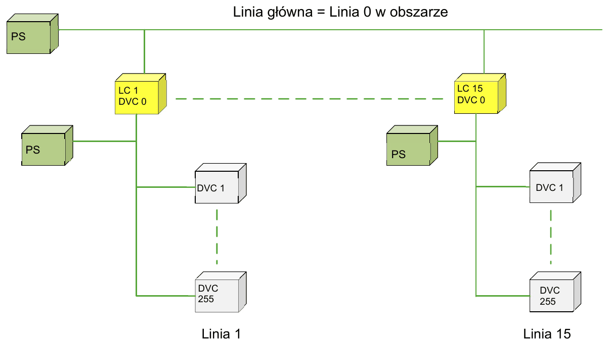{ loading=lazy }](../assets/img/topologia/rys03-obszar.png)
  <figcaption>Rysunek 3: Topologia, obszar</figcaption>
</figure>

Gdy jeden segment linii nie wystarcza, do **linii głównej** można podłączyć do **15 linii** przez sprzęgła liniowe. Taka struktura to **obszar**.

Sprzęgła liniowe należą do linii podrzędnej, ale pobierają prąd z linii głównej, więc zmniejszają liczbę urządzeń, które można na niej zainstalować. Na linii głównej mieści się do 256 urządzeń, ale przy 15 sprzęgłach liniowych i 1 sprzęgle obszarowym nie wszystkie adresy indywidualne linii głównej da się wykorzystać jednocześnie.

Każda linia podrzędna i linia główna muszą mieć **osobny zasilacz KNX**. Licząc urządzenia na linii głównej i liniach podrzędnych, obszar KNX TP obsłuży **ponad 4000 urządzeń**.

!!! warning "Uwaga"

    Wzmacniaczy liniowych nie stosuje się na linii głównej.

## Kilka obszarów (sieć)

<figure markdown="span">
  [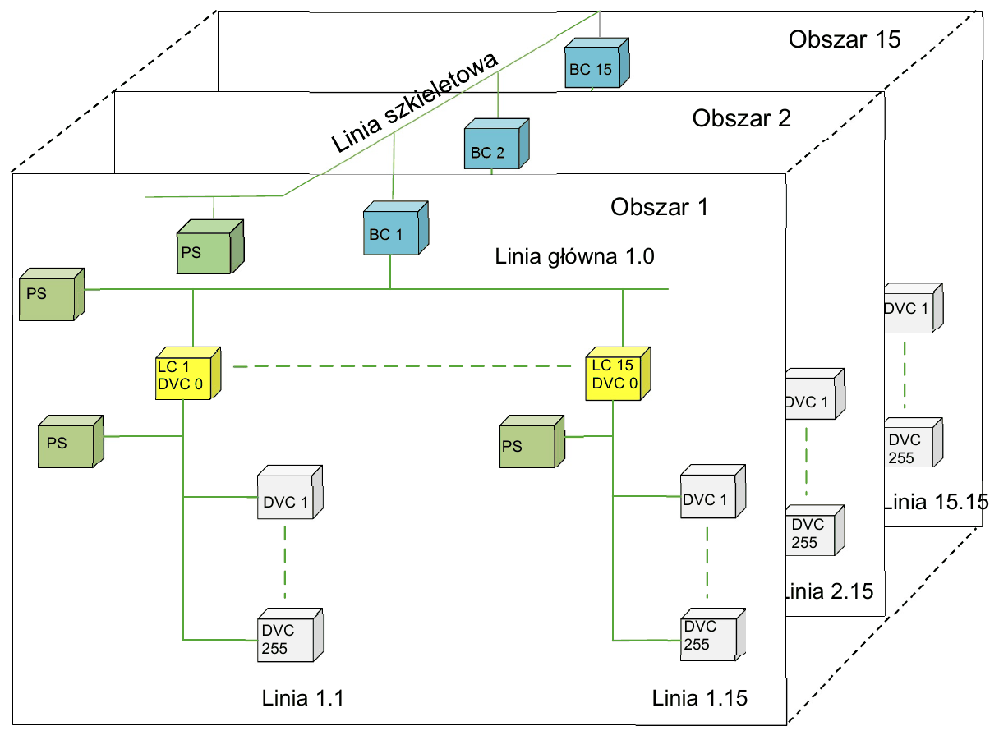{ loading=lazy }](../assets/img/topologia/rys04-kilka-obszarow.png)
  <figcaption>Rysunek 4: Topologia, kilka obszarów</figcaption>
</figure>

Gdy potrzeba jeszcze więcej urządzeń, instalację rozbudowuje się o **linię obszarową (szkieletową)**, do której obszary dołącza się **sprzęgłami obszarowymi**.

Podobnie jak sprzęgła liniowe, sprzęgła obszarowe należą do linii podrzędnej (tu: linii głównej), ale pobierają prąd z linii szkieletowej i zmniejszają liczbę urządzeń, które można na niej zainstalować.

Linia szkieletowa wymaga osobnego zasilacza KNX. Dzięki liniom, obszarom i linii szkieletowej sieć KNX TP skaluje się do **ponad 61 000 urządzeń**.

!!! warning "Uwaga"

    Wzmacniaczy liniowych nie stosuje się na linii obszarowej (szkieletowej).

## Adres indywidualny w topologii TP [E]

<figure markdown="span">
  [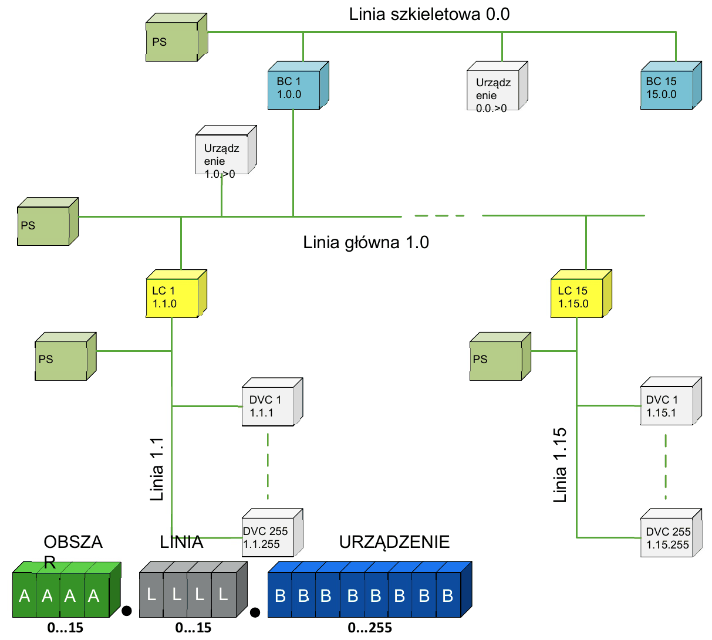{ loading=lazy }](../assets/img/topologia/rys05-adres-indywidualny.png)
  <figcaption>Rysunek 5: Adres indywidualny</figcaption>
</figure>

Każde urządzenie KNX TP ma unikalny **adres indywidualny**, który jednoznacznie określa jego miejsce w topologii. Format: **A.L.B** (obszar.linia.urządzenie magistralne).

| Pole | Zakres | Znaczenie |
| --- | --- | --- |
| A | 1…15 | obszary 1–15 |
| A | 0 | urządzenia na linii szkieletowej |
| L | 1…15 | linie 1–15 w obszarze A |
| L | 0 | linia główna danego obszaru |
| B | 1…255 | urządzenia magistralne na linii L |
| B | 0 | sprzęgło liniowe danej linii |

Nowe urządzenie przy pierwszym włączeniu ma zwykle domyślny adres **15.15.255**. Po rozładowaniu w ETS urządzenie wraca do 15.15.255, z wyjątkiem sprzęgieł i routerów IP, które dostają **15.15.0**. Taki adres oznacza urządzenie niezaprogramowane, jeszcze nieprzypisane do miejsca w topologii. Wszystkie nowe urządzenia wychodzą z fabryki z tym adresem, dopóki nie skonfiguruje się ich w ETS.

## Sprzęgła z funkcją bramki

<figure markdown="span">
  [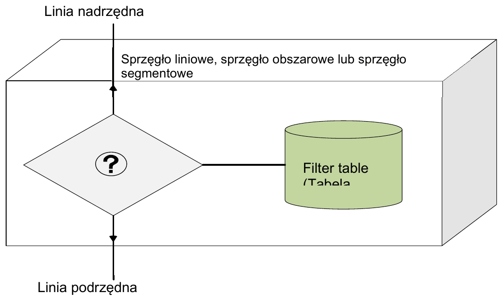{ loading=lazy }](../assets/img/topologia/rys06-sprzeglo-funkcja-bramki.png)
  <figcaption>Rysunek 6: Sprzęgła KNX z funkcją bramki</figcaption>
</figure>

Sprzęgła (liniowe, obszarowe i segmentowe) zarządzają komunikacją między liniami, **filtrując telegramy**. Każde działa jak bramka, która decyduje, co przechodzi dalej.

- Po nadaniu sprzęgłu poprawnego adresu indywidualnego ETS sam tworzy dla niego **tabelę filtrów** już na etapie projektu.
- Tabela zawiera tylko te adresy grupowe, których używają urządzenia po obu stronach sprzęgła.
- Sprzęgło przekazuje wyłącznie telegramy z adresami grupowymi z tej tabeli, więc każda linia pracuje niezależnie, a ruch na magistrali maleje.
- Żółte diody LED migają, gdy sprzęgło odbiera i przetwarza telegramy z danej linii.

!!! note "Uwaga"

    Wzmacniacze liniowe nie mają tabeli filtrów i przekazują wszystkie telegramy (zob. [Sprzęgła: obszary zastosowań](#sprzega-obszary-zastosowan)).

## Sprzęgło KNX: schemat blokowy

<figure markdown="span">
  [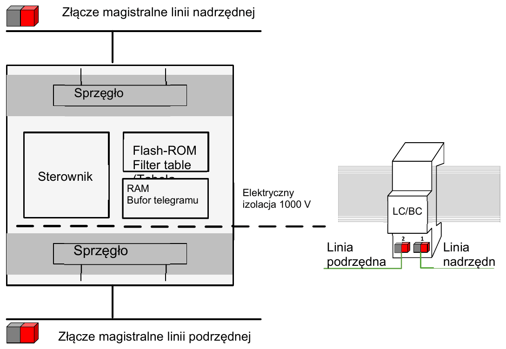{ loading=lazy }](../assets/img/topologia/rys07-sprzeglo-schemat-blokowy.png)
  <figcaption>Rysunek 7: Sprzęgło liniowe, schemat blokowy</figcaption>
</figure>

Sprzęgło KNX to urządzenie na szynę DIN, które łączy linię nadrzędną (pierwotną) z podrzędną (wtórną) i kontroluje komunikację między nimi. Obie linie podłącza się standardowymi złączami magistralnymi.

- Sprzęgło można programować zarówno od strony linii nadrzędnej, jak i podrzędnej.
- Jest **zasilane z linii nadrzędnej**. Aby działać jako sprzęgło, musi być też podłączone do linii podrzędnej z własnym zasilaczem.
- Dzięki zasilaniu z linii nadrzędnej może wykryć i zgłosić zanik zasilania linii podrzędnej.
- Ma pamięć Flash ROM i zapewnia **izolację galwaniczną** (1000 V) między liniami.

## Sprzęgła: obszary zastosowań

<figure markdown="span">
  [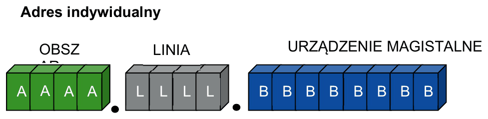{ loading=lazy }](../assets/img/topologia/rys08a-format-adresu.png)
</figure>

<figure markdown="span">
  [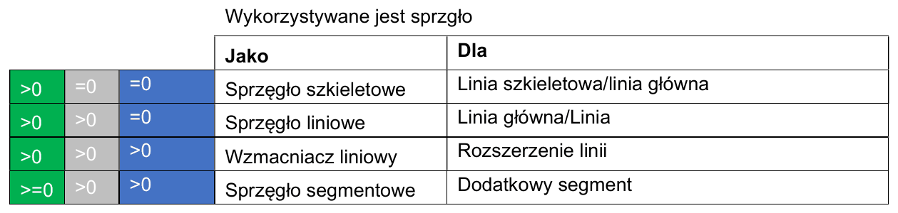{ loading=lazy }](../assets/img/topologia/rys08-rodzaje-sprzegiel.png)
  <figcaption>Rysunek 8: Sprzęgło, rodzaje zastosowań</figcaption>
</figure>

Sprzęgło obszarowe, liniowe, wzmacniacz liniowy i sprzęgło segmentowe mogą być **tym samym urządzeniem**. Funkcję wyznacza miejsce montażu i nadany adres indywidualny.

| A | L | B | Sprzęgło pracuje jako | Łączy |
| --- | --- | --- | --- | --- |
| >0 | =0 | =0 | sprzęgło obszarowe (szkieletowe) | linia szkieletowa / linia główna |
| >0 | >0 | =0 | sprzęgło liniowe | linia główna / linia |
| >0 | >0 | >0 | wzmacniacz liniowy | rozszerzenie linii |
| ≥0 | >0 | >0 | sprzęgło segmentowe | dodatkowy segment |

**Typy sprzęgieł i ich funkcje**

| Typ sprzęgła | Połączenie między | Funkcja |
| --- | --- | --- |
| Sprzęgło obszarowe | linia szkieletowa ↔ linia główna | podłączenie do 15 obszarów przez linię obszarową |
| Sprzęgło liniowe | linia główna ↔ linia | podłączenie do 15 linii do linii głównej obszaru |
| Sprzęgło segmentowe | segment główny ↔ podsegmenty | tworzenie podsegmentów z filtrowaniem |
| Wzmacniacz liniowy (może go zastąpić sprzęgło segmentowe) | segment główny ↔ podsegmenty | przedłuża segment linii o maks. 3 kolejne segmenty, gdy 1000 m kabla nie wystarcza na 256 urządzeń; **nie filtruje** |

!!! tip "Kiedy wzmacniacz liniowy"

    Jeśli 256 urządzeń TP mieści się na 1000 m kabla, wzmacniacze są zbędne. Gdy kabla trzeba więcej, na każde kolejne 1000 m stosuje się jeden wzmacniacz, najwyżej trzy, co daje łącznie maks. 4000 m.

Sprzęgła obszarowe, liniowe i segmentowe przekazują telegramy między liniami na podstawie tabel filtrów z ETS; wzmacniacz linii przekazuje wszystko. Rolę sprzęgła wyznacza adres indywidualny, np.:

- **1.1.0**: sprzęgło liniowe linii 1 w obszarze 1,
- **8.0.0**: sprzęgło obszarowe obszaru 8.

**Dlaczego poprawny adres jest ważny.** Sprzęgła rozpoznają urządzenia swojej linii lub obszaru po własnym adresie indywidualnym. Przykład przy programowaniu w ETS:

- ETS wysyła telegram do urządzenia **1.2.20**,
- sprzęgło liniowe **1.3.0 nie przekaże** go, bo 1.2.20 nie leży w jego linii,
- dlatego urządzenie musi być zamontowane we właściwej linii i mieć adres zgodny z topologią.

### Sprzęgła segmentowe w KNX

Sprzęgła segmentowe pojawiły się w **ETS6**, aby zwiększyć elastyczność, poprawić filtrowanie i ułatwić łączenie mediów KNX (np. TP i RF). Powody:

- rozbudowa istniejących linii TP o urządzenia RF (lub kolejne urządzenia TP),
- brak potrzeby montowania sprzęgieł mediów na linii głównej (zob. sieć hybrydowa w części o KNX RF),
- sprzęgła mediów RF nie dało się dołączyć, gdy była tylko jedna linia TP (np. 1.1) bez linii głównej,
- sprzęgła segmentowe pozwalają rozgałęzić linię TP i dołączyć urządzenia RF lub TP,
- filtrują telegramy między segmentami, podczas gdy wzmacniacze liniowe TP przekazują cały ruch, także tam, gdzie nie jest potrzebny,
- filtrowanie wyraźnie poprawia wydajność sieci.

### Sprzęgła segmentowe w ETS6

Od ETS6 panel topologii lepiej obsługuje segmenty i rodzaje mediów.

<figure markdown="span">
  [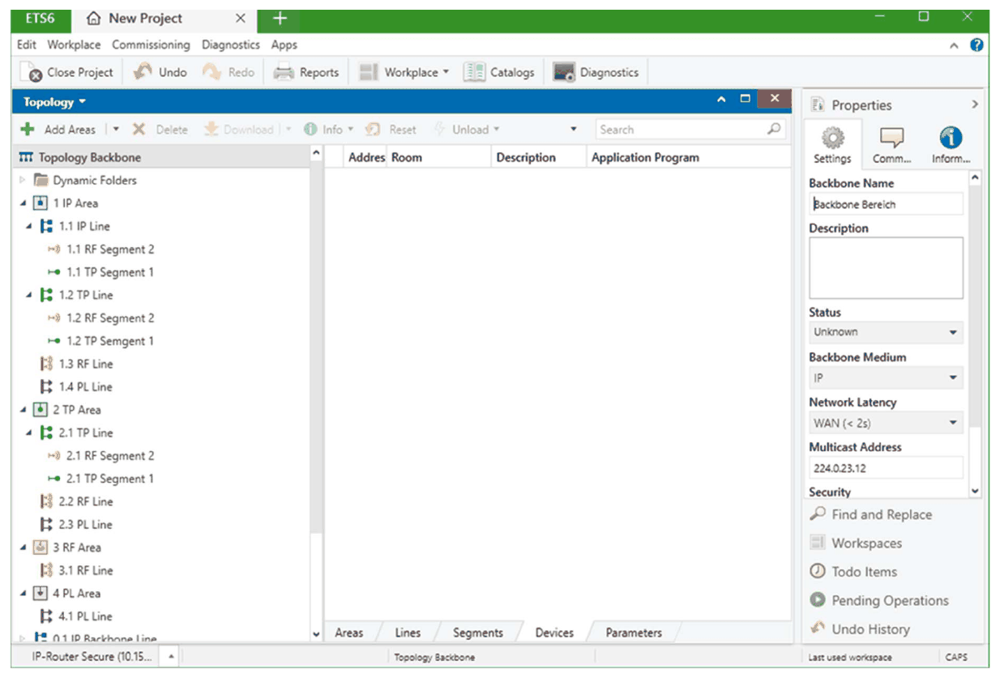{ loading=lazy }](../assets/img/topologia/rys09-ets6-panel-topologii.png)
  <figcaption>Rysunek 9: Panel topologii ETS ze sprzęgłami segmentowymi</figcaption>
</figure>

Kolory mediów w ETS6:

- **zielony**: TP (Twisted Pair),
- **pomarańczowy**: RF (Radio Frequency),
- **niebieski**: IP (Internet Protocol).

Co daje panel topologii:

- Po wybraniu linii osobna zakładka pokazuje wszystkie jej segmenty i urządzenia.
- W informacjach o sprzęgle segmentowym widać **tabelę filtrów adresów grupowych** i **tabelę filtrów adresów indywidualnych**.
- Do każdej linii (segmentu głównego) można dodać wiele podsegmentów TP lub RF, połączonych sprzęgłem segmentowym.
- Podsegmenty mogą mieć inne medium niż segment główny, np. urządzenie RF **1.1.44** może siedzieć w podsegmencie RF za sprzęgłem TP/RF dołączonym do segmentu głównego TP.

**Przykłady w ETS6**

<figure markdown="span">
  [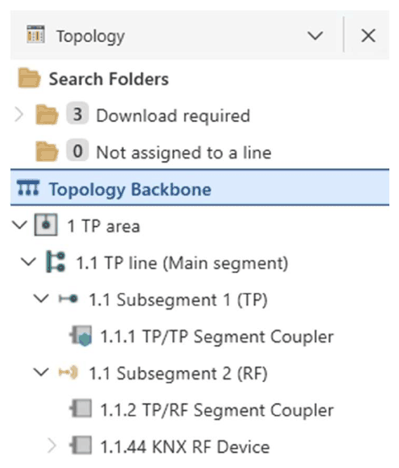{ loading=lazy }](../assets/img/topologia/ets6-segmenty-1.png)
  <figcaption>Obszar TP z jedną linią i dwoma podsegmentami: TP i RF. Za sprzęgłem segmentowym można dodać dowolną liczbę urządzeń.</figcaption>
</figure>

<figure markdown="span">
  [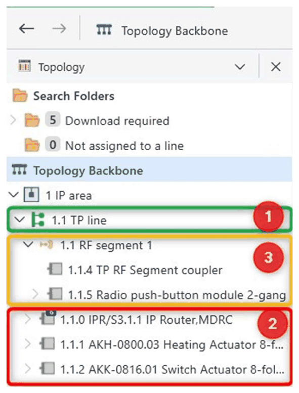{ loading=lazy }](../assets/img/topologia/ets6-segmenty-2.png)
  <figcaption>Linia TP (zielona, 1) z urządzeniami TP w segmencie głównym (czerwone, 2) i segmentem RF ze sprzęgłem TP/RF (pomarańczowy, 3).</figcaption>
</figure>

<figure markdown="span">
  [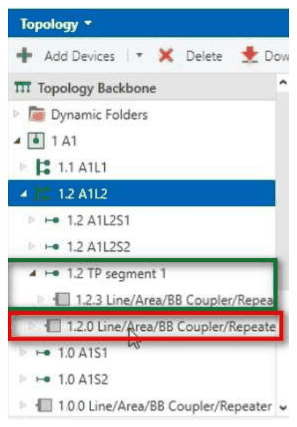{ loading=lazy }](../assets/img/topologia/ets6-segmenty-3.png)
  <figcaption>Linia 1.2 ze sprzęgłem 1.2.0 i kilkoma segmentami. Przeciągnięcie sprzęgła z funkcją wzmacniacza tworzy nowy segment i przypisuje do niego wzmacniacz (zielony).</figcaption>
</figure>

<figure markdown="span">
  [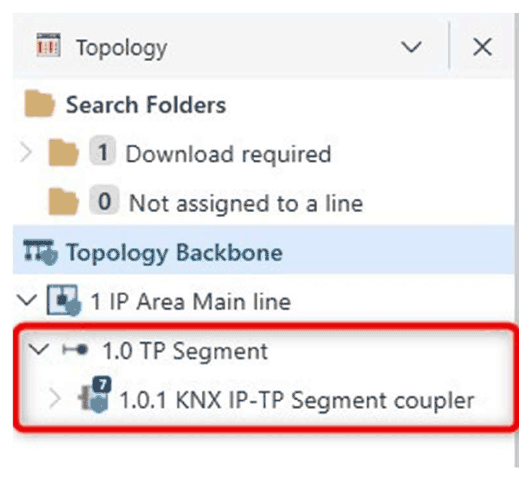{ loading=lazy }](../assets/img/topologia/ets6-segmenty-4.png)
  <figcaption>Segment TP podłączony bezpośrednio do szkieletu IP przez sprzęgło segmentowe IP/TP (czerwone). Gotowy segment można powielać funkcją „Wklej specjalnie”, np. w „scenariuszu hotelowym”.</figcaption>
</figure>

!!! note "Adresy urządzeń w segmentach są elastyczne"

    Urządzenia nie muszą trzymać się zakresów adresów na segment. Na przykład 1.1.77 i 1.1.90 mogą być w segmencie 1, a 1.1.85 w segmencie 2.

!!! warning "Pamiętaj"

    - Na linii nadal może być najwyżej **256 urządzeń**, wliczając wszystkie sprzęgła segmentowe.
    - Każdy segment TP (główny i podsegmenty) musi mieć **własny zasilacz**.

**Filtrowanie adresów w sprzęgłach segmentowych**

*Adresy grupowe (normalna praca):*

- Sprzęgła segmentowe, tak jak liniowe i obszarowe, mają tabelę filtrów dla telegramów grupowych.
- ETS zarządza nią automatycznie na podstawie powiązań adresów grupowych z urządzeniami w segmencie.

*Adresy indywidualne (programowanie w ETS):*

- Sprzęgło segmentowe wie, jakie adresy indywidualne mają urządzenia w jego segmencie.
- Sprzęgła obszarowe i liniowe wnioskują o położeniu urządzenia z numeru obszaru i linii, a segmentowe dostają tę informację z ETS (tabela filtrów adresów indywidualnych).
- Po każdym dodaniu urządzenia lub zmianie adresu w podsegmencie **sprzęgło segmentowe trzeba zaprogramować ponownie**.
- Gdy tymczasowo podłączysz interfejs do segmentu (np. do diagnostyki), ETS tymczasowo dopisuje jego adres do filtrowanych adresów indywidualnych.

## Łączenie kilku linii

<figure markdown="span">
  [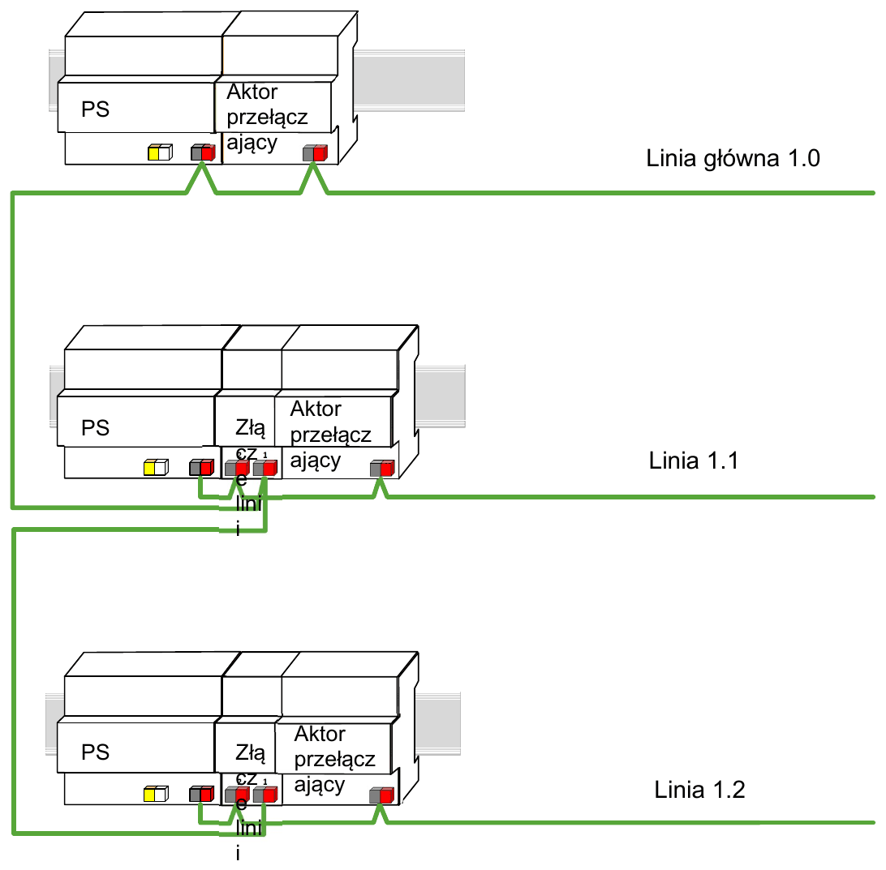{ loading=lazy }](../assets/img/topologia/rys10-laczenie-linii.png)
  <figcaption>Rysunek 10: Łączenie kilku linii (przykład dla obszaru 1)</figcaption>
</figure>

Gdy instalacja TP ma wiele linii, **każda linia i każdy segment linii ma własny zasilacz z dławikiem**. Zarówno linia podrzędna (np. 1.1), jak i nadrzędna (linia główna 1.0) łączą się ze sprzęgłem liniowym standardowymi złączami magistralnymi.

## Praktyczny przykład działania [E]

<figure markdown="span">
  [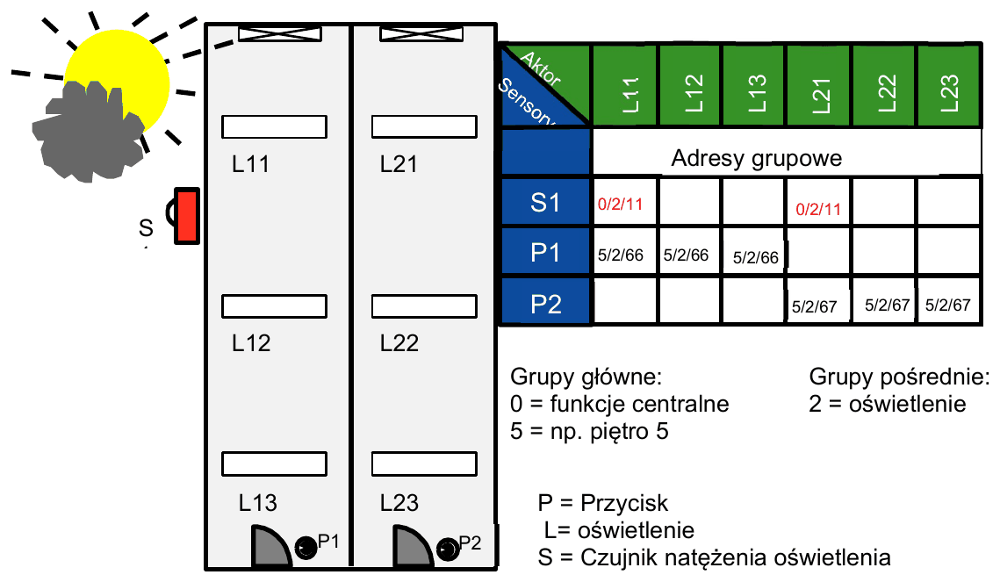{ loading=lazy }](../assets/img/topologia/rys11-przyklad-praktyczny.png)
  <figcaption>Rysunek 11: Praktyczny przykład</figcaption>
</figure>

| Nadawca | Adres grupowy | Odbiorcy (aktory) |
| --- | --- | --- |
| Przycisk P1 | 5/2/66 | L11, L12, L13 |
| Przycisk P2 | 5/2/67 | L21, L22, L23 |
| Czujnik jasności S1 | 0/2/11 | L11, L21 (światła przy oknach) |

Grupy główne: 0 = funkcje centralne, 5 = np. piętro 5. Grupa pośrednia 2 = oświetlenie.

W ETS przyciskowi P1 i aktorom lamp L11–L13 przypisano ten sam adres 5/2/66; analogicznie P2 i L21–L23 dostały 5/2/67. Czujnik S1 i aktory lamp przy oknach mają 0/2/11. Światła przy oknach można więc włączać i wyłączać zarówno przyciskami P1 i P2, jak i czujnikiem jasności S1.

## Telegram w obrębie jednej linii [E]

<figure markdown="span">
  [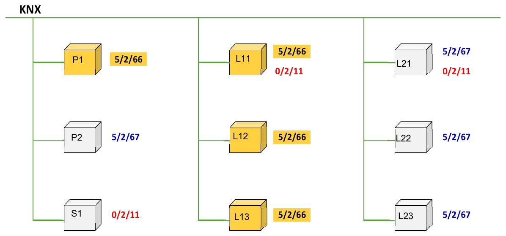{ loading=lazy }](../assets/img/topologia/rys12-telegram-w-linii.png)
  <figcaption>Rysunek 12: Telegram w obrębie jednej linii</figcaption>
</figure>

- Naciśnięcie P1 wysyła telegram na adres grupowy **5/2/66**. Odbierają go i analizują wszystkie urządzenia, ale polecenie wykonują tylko aktory L11, L12 i L13.
- Gdy czujnik S1 wyśle telegram na **0/2/11**, odbierają go wszyscy, a reagują tylko aktory L11 i L21 (oświetlenie przy oknach).

## Telegram z linii do linii

<figure markdown="span">
  [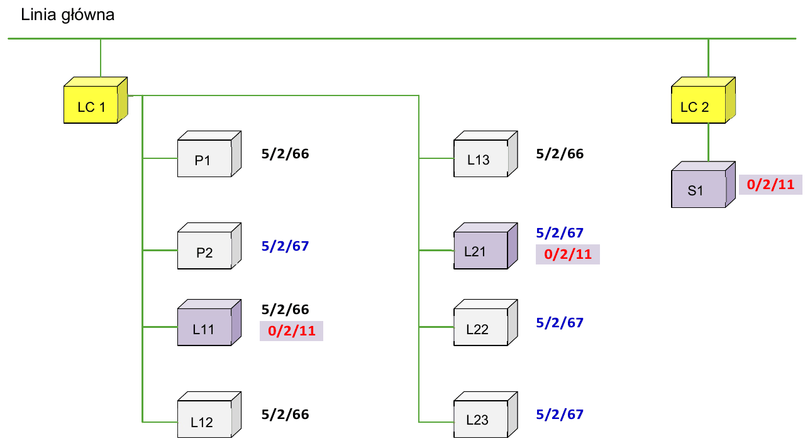{ loading=lazy }](../assets/img/topologia/rys13-telegram-linia-linia.png)
  <figcaption>Rysunek 13: Telegram przechodzący z linii do linii</figcaption>
</figure>

Czujnik S1 jest w linii 2, a ma sterować lampami L11 i L21 w linii 1, więc jego telegram musi przejść przez linię główną:

1. S1 wysyła telegram na adres grupowy 0/2/11.
2. Sprzęgło liniowe **LC 2** widzi, że na ten adres reagują urządzenia w innej linii, i przekazuje telegram na linię główną.
3. Sprzęgło liniowe **LC 1** widzi, że adres 0/2/11 jest potrzebny w linii 1, i przekazuje go dalej.
4. Wszystkie urządzenia linii 1 odbierają telegram, a polecenie wykonują tylko aktory L11 i L21.

## Telegram z obszaru do obszaru

<figure markdown="span">
  [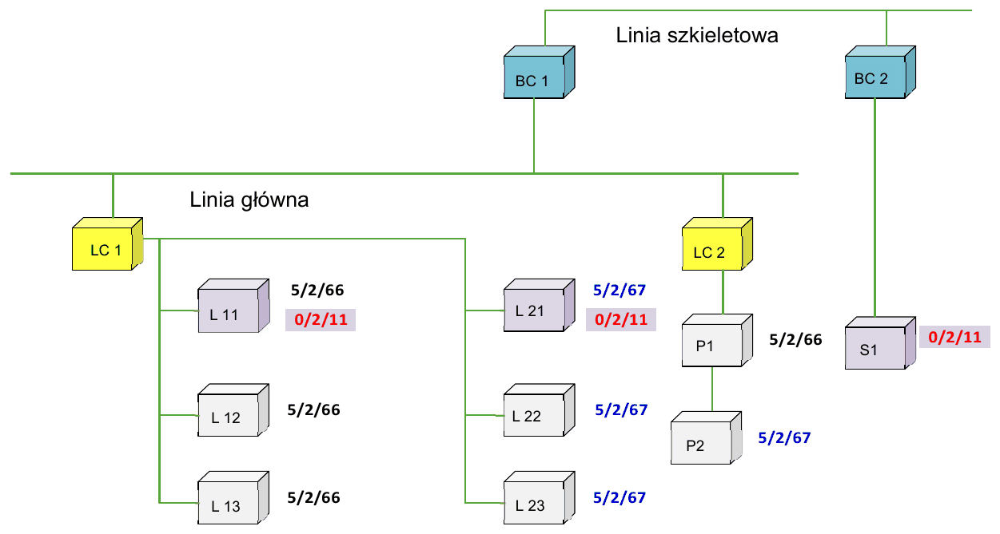{ loading=lazy }](../assets/img/topologia/rys14-telegram-obszar-obszar.png)
  <figcaption>Rysunek 14: Telegram przechodzący z obszaru do obszaru</figcaption>
</figure>

Czujnik S1 jest w innym obszarze, a steruje lampami L11 i L21 w obszarze 1, linii 1, więc telegram musi przejść przez linię szkieletową:

1. S1 wysyła telegram na adres grupowy 0/2/11.
2. Sprzęgło obszarowe **BC 2** widzi, że na ten adres reagują urządzenia poza jego obszarem, i wysyła telegram na linię szkieletową.
3. Sprzęgło obszarowe **BC 1** rozpoznaje, że telegram jest potrzebny w obszarze 1, i kieruje go do linii głównej, do sprzęgła **LC 1**.
4. LC 1 przekazuje telegram do linii 1.
5. Wszystkie urządzenia linii 1 odbierają telegram, a polecenie wykonują tylko aktory L11 i L21.

## Licznik przejść w sprzęgłach

<figure markdown="span">
  [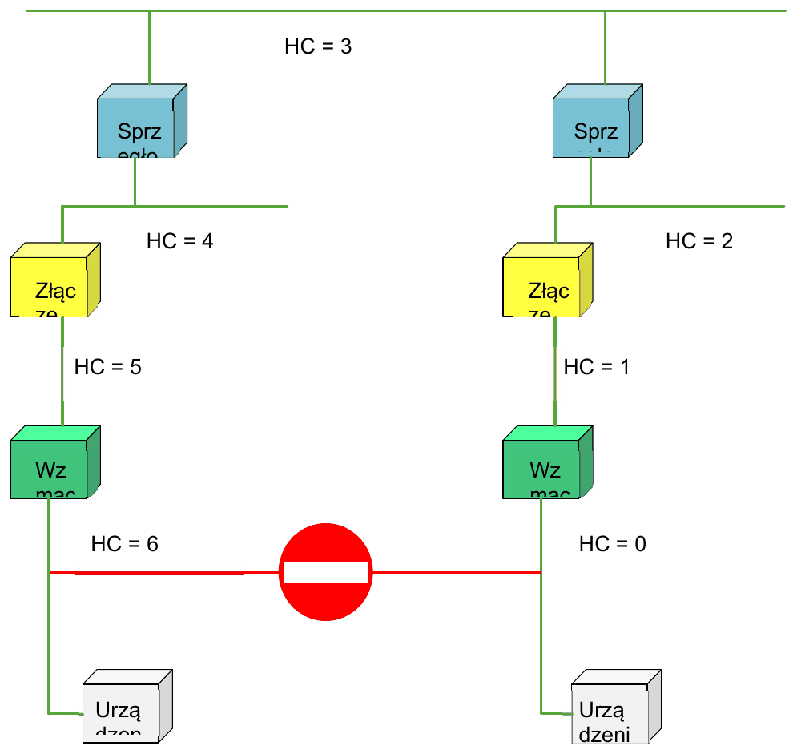{ loading=lazy }](../assets/img/topologia/rys15-licznik-przejsc.png)
  <figcaption>Rysunek 15: Licznik przejść (HC)</figcaption>
</figure>

Licznik przejść (hop count) ogranicza, jak daleko telegram może wędrować przez linie i obszary. Chroni sieć przed telegramami krążącymi bez końca, np. przy przypadkowej pętli.

- Każdy telegram startuje z licznikiem przejść równym **6**.
- Każde sprzęgło liniowe, obszarowe i wzmacniacz linii **zmniejsza licznik o 1** przed przekazaniem telegramu.
- Telegram jest przekazywany, dopóki licznik nie spadnie do **0**; wtedy dalsze przekazywanie ustaje.
- Niezależnie od licznika sprzęgło przepuszcza telegram tylko wtedy, gdy pozwala na to tabela filtrów.

## Struktura budynku

<figure markdown="span">
  [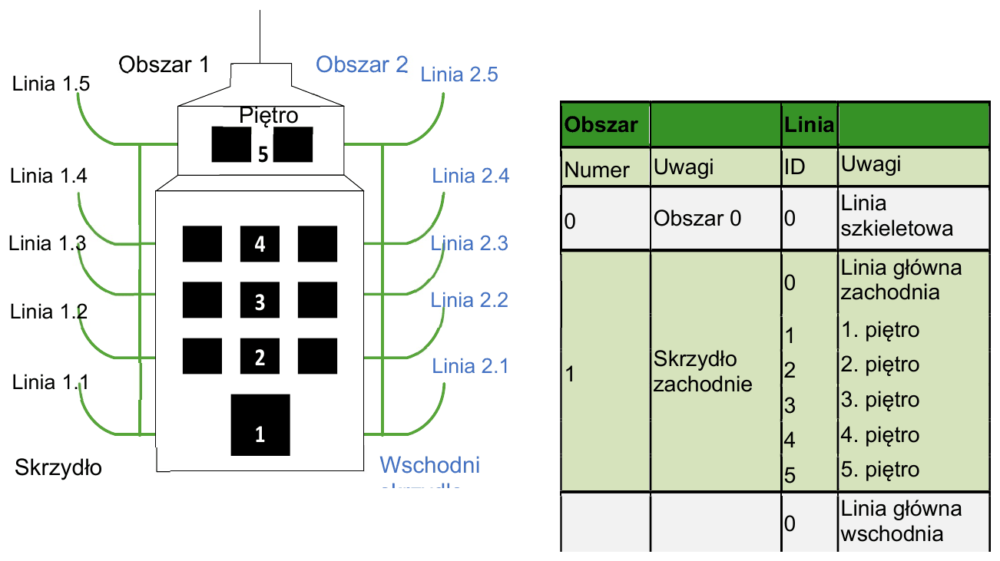{ loading=lazy }](../assets/img/topologia/rys16-struktura-budynku.png)
  <figcaption>Rysunek 16: Podział na linie w projekcie średniej wielkości (przykład)</figcaption>
</figure>

W budynku średniej wielkości najlepiej dopasować topologię do jego fizycznego układu. Ułatwia to montaż, utrzymanie i szukanie usterek.

- **Numery linii = numery pięter**, np. linia 1 to pierwsze piętro, linia 2 drugie.
- **Numery obszarów = budynki lub skrzydła**, np. obszar 1 to skrzydło zachodnie, obszar 2 wschodnie.

Nie zawsze da się to zrobić idealnie, ale topologia oparta o układ budynku upraszcza instalację i zwiększa niezawodność dzięki sprzęgłom liniowym oraz osobnemu zasilaczowi na każdej linii, linii głównej i linii szkieletowej.

## Klasyczna struktura sprzęgieł obszarowych i liniowych

<figure markdown="span">
  [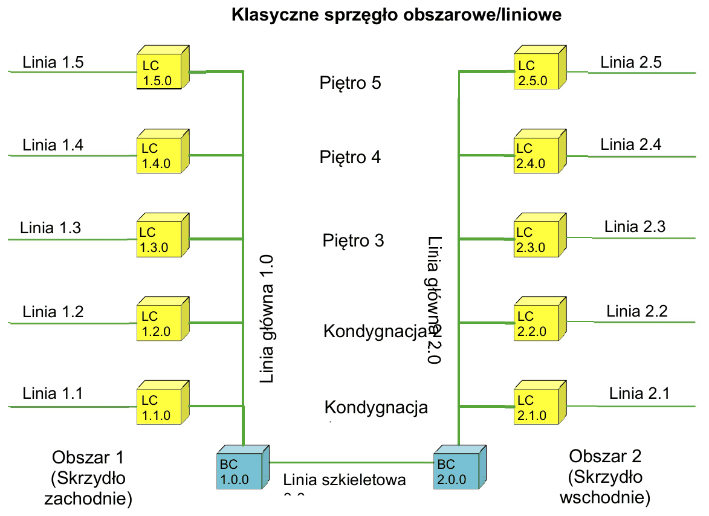{ loading=lazy }](../assets/img/topologia/rys17-klasyczna-struktura.png)
  <figcaption>Rysunek 17: Klasyczna struktura sprzęgieł obszarowych i liniowych (budynek z rysunku 16)</figcaption>
</figure>

## Interfejsy wewnętrzne i zewnętrzne

<figure markdown="span">
  [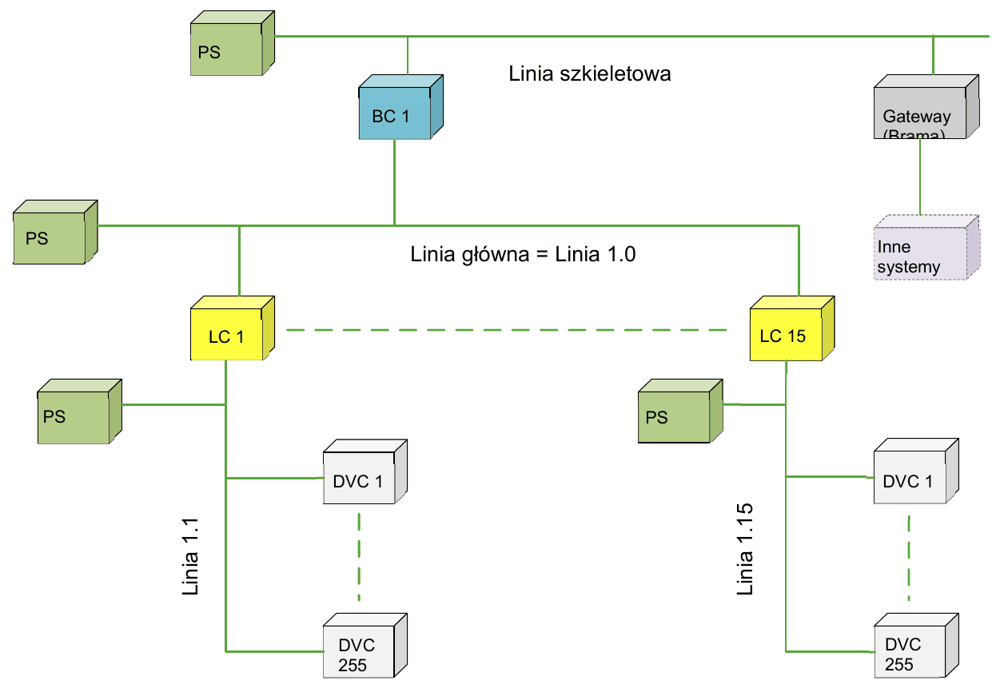{ loading=lazy }](../assets/img/topologia/rys18-interfejsy.png)
  <figcaption>Rysunek 18: KNX, interfejsy wewnętrzne i zewnętrzne</figcaption>
</figure>

KNX łączy się z innymi systemami przez interfejsy i bramki:

- linię szkieletową (lub dowolną inną) można połączyć z systemem zewnętrznym przez **bramkę (gateway)**,
- bramka zapewnia dwukierunkową konwersję protokołów,
- przykłady systemów zewnętrznych: systemy AV, sterowniki logiczne, systemy zarządzania budynkiem (BMS), wizualizacje i panele, internet i zdalny dostęp.

**Bramki umieszcza się na najwyższym poziomie topologii** (np. na linii szkieletowej), aby nie obciążać niższych linii i zapewnić telegramom sprawną drogę do interfejsów zewnętrznych.

Podobnie **sprzęgła mediów** łączą różne media KNX (np. TP i RF albo IP i TP). Odległe części instalacji można też połączyć **światłowodem**, który daje:

- większy zasięg niż linia TP,
- izolację elektryczną (brak zakłóceń i problemów z uziemieniem),
- szybką i bezpieczną komunikację w dużych obiektach.

## Sieć KNX IP dla większego ruchu

<figure markdown="span">
  [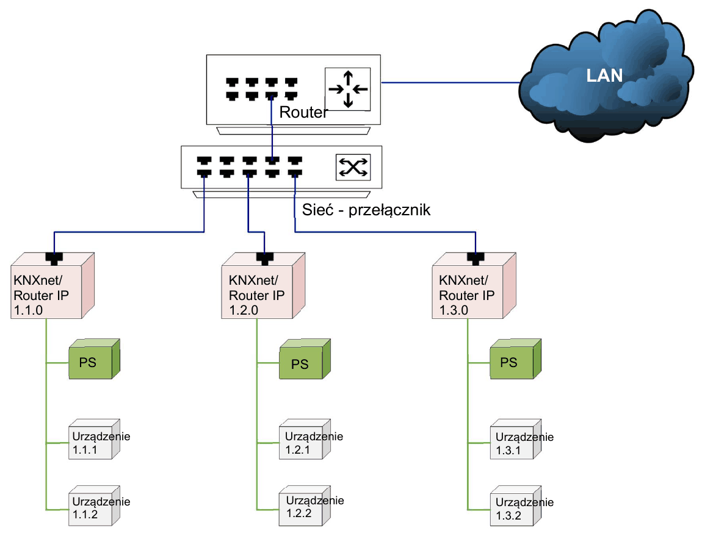{ loading=lazy }](../assets/img/topologia/rys19-siec-ip.png)
  <figcaption>Rysunek 19: Sieć IP, wyższe prędkości przesyłania telegramów</figcaption>
</figure>

Gdy instalacja rośnie i łączy się z systemami zewnętrznymi, ruch telegramów może przeciążyć topologię opartą wyłącznie na TP. Wtedy linię główną lub szkieletową zastępuje się siecią IP, a sprzęgła liniowe i obszarowe **routerami KNXnet/IP**.

Dlaczego IP zamiast TP na linii głównej lub szkieletowej:

- TP ma przepustowość **9600 bit/s**, za mało dla dużych projektów,
- przez przełączniki gigabitowe telegramy płyną nawet **100 000 razy szybciej** niż po TP,
- KNX over IP ułatwia integrację z systemami zewnętrznymi: centralne sterowanie, wizualizację, zdalny dostęp.

**Tunelowanie i routing przez KNXnet/IP**

- **Tunelowanie** służy do programowania ETS przez IP.
- **Routing** działa jak sprzęgło liniowe: wysyła i odbiera telegramy między liniami zgodnie z tabelą filtrów.
- Router wysyłający telegram między liniami nadaje go na **adres multicast IP**; pozostałe routery nasłuchują i sprawdzają swoje tabele filtrów, zanim go przekażą lub zablokują.

!!! warning "Multicast w sieciach KNX IP"

    - KNX używa zarejestrowanego na świecie adresu multicast **224.0.23.12**, ustawionego fabrycznie w routerach KNXnet/IP.
    - Adres można zmienić w ETS w dozwolonym zakresie.
    - Przełącznik lub router w sieci LAN **musi obsługiwać multicast**; przed wdrożeniem skonsultuj to z administratorem sieci.
    - Multicast nie działa przez internet, chyba że przez VPN.

**Interfejs KNX IP a router KNXnet/IP**

| Cecha | Interfejs KNX IP | Router KNXnet/IP |
| --- | --- | --- |
| Tunelowanie (programowanie ETS) | tak | tak |
| Routing (filtrowanie i przekazywanie telegramów) | nie | tak |
| Multicast dla telegramów między liniami | nie | tak |

- **Interfejsy KNX IP** służą do programowania w ETS i zdalnego dostępu, nie robią routingu.
- **Routery KNXnet/IP** robią tunelowanie i routing, więc mogą zastąpić sprzęgła liniowe i obszarowe, a przy okazji służą jako interfejs zdalnego dostępu.

**Zdalny dostęp i chmura.** Niektóre urządzenia KNX dają bezpieczny dostęp przez portal w chmurze: zdalne programowanie w ETS (tunelowanie), podgląd i sterowanie komunikacją grupową, serwis z dowolnego miejsca. Łączą się jako urządzenia IP i nie mają funkcji routingu.

## Sprzęgła liniowe zastąpione routerami KNXnet/IP

<figure markdown="span">
  [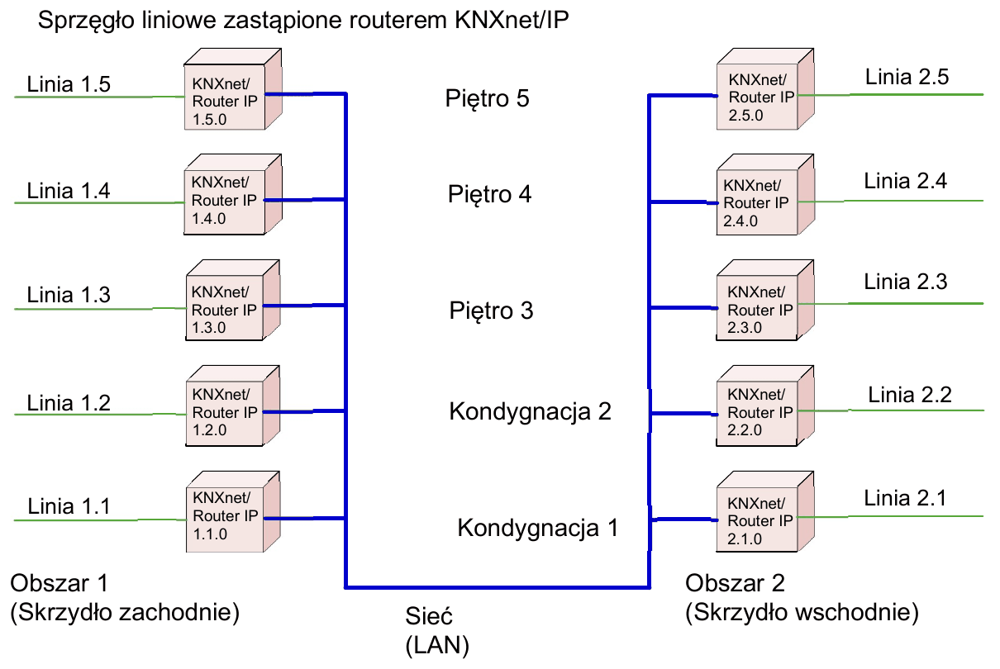{ loading=lazy }](../assets/img/topologia/rys20-routery-ip.png)
  <figcaption>Rysunek 20: Budynek z rysunku 16, sprzęgła liniowe zastąpione routerami KNXnet/IP (przypadek 1)</figcaption>
</figure>

Routery KNXnet/IP mogą zastąpić klasyczne sprzęgła liniowe i obszarowe; linię szkieletową i linie główne przejmuje wtedy Ethernet.

=== "Przypadek 1: routery zamiast sprzęgieł liniowych"

    - Linie główne i linia szkieletowa w całości przechodzą na Ethernet.
    - Każda linia KNX TP zostaje bez zmian, ale łączy się przez router KNXnet/IP zamiast sprzęgła liniowego.
    - Wyraźnie rośnie szybkość komunikacji i maleją zatory telegramów.
    - **Najlepszy dla projektów z dużą liczbą telegramów.**

=== "Przypadek 2: routery zamiast sprzęgieł obszarowych"

    - Linie główne zostają na TP z klasycznymi sprzęgłami liniowymi.
    - Na Ethernet przechodzi tylko linia szkieletowa.
    - Przyspiesza szkielet przy zachowaniu istniejących linii głównych TP.
    - **Najlepszy dla istniejących instalacji TP**, którym brakuje szybkości na szkielecie.

Połączenie obu przypadków jest możliwe, ale tylko w wyjątkowych sytuacjach (omawia je kurs KNX Advanced).

## Ograniczenia routerów KNXnet/IP

Ethernet daje dużą przepustowość i minimalizuje utratę telegramów, ale nie zapobiegnie przeciążeniu, gdy telegramy z wielu linii trafiają do jednej linii.

!!! example "Metafora"

    Autostrada ma 1000 pasów i 100 wjazdów, ale wszystkie samochody muszą zjechać jednym pasem. Powstaje gigantyczny korek. Tak samo jest, gdy wiele linii jednocześnie wysyła telegramy do jednej linii TP: robi się wąskie gardło, rosną opóźnienia, a telegramy mogą przepaść. To typowy problem każdej sieci o strukturze siatki (mesh), nie tylko KNX.

**Jak nie przeciążyć sieci KNXnet/IP**

- Rozmieszczaj urządzenia w topologii z głową.
- Konfiguruj urządzenia tak, by nie generowały nadmiernego ruchu na jednej linii.
- Korzystaj z tabel filtrów w routerach KNXnet/IP, aby ograniczyć przesyłanie niepotrzebnych telegramów między liniami.
- Rozsądnie zarządzaj telegramami zwrotnymi (statusami) i cyklicznymi; ograniczaj automatyczne statusy, zwłaszcza gdy wiele urządzeń komunikuje się z jednym systemem centralnym.
- Ostrożnie ustawiaj częstotliwość telegramów cyklicznych (np. czujników wysyłających dane co stały czas).
