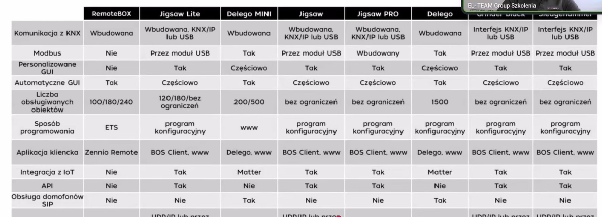

# Serwery wizualizacji KNX

Serwer wizualizacji łączy się z magistralą KNX i udostępnia sterowanie instalacją w aplikacji lub przeglądarce. Korzysta z tych samych adresów grupowych co przyciski i aktory (zob. [Adresowanie i działanie grup](../podstawy/adresowanie.md)), więc instalacja działa dalej, nawet gdy serwer jest wyłączony.

Poniższe porównanie pochodzi ze zrzutu tabeli z prezentacji szkoleniowej EL-TEAM Group Szkolenia (12.10.2026).

## Tabela przepisana ze zrzutu

| Cecha | RemoteBOX | Jigsaw Lite | Delego MINI | Jigsaw | Jigsaw PRO | Delego | Grinder black* | Sledgehammer* |
| --- | --- | --- | --- | --- | --- | --- | --- | --- |
| Komunikacja z KNX | wbudowana | wbudowana, KNX/IP lub USB | wbudowana | wbudowana, KNX/IP lub USB | wbudowana, KNX/IP lub USB | wbudowana | interfejs KNX/IP lub USB | interfejs KNX/IP lub USB |
| Modbus | nie | przez moduł USB | tak | przez moduł USB | wbudowany | tak | przez moduł USB | przez moduł USB |
| Personalizowane GUI | nie | tak | częściowo | tak | tak | częściowo | tak | tak |
| Automatyczne GUI | tak | częściowo | tak | częściowo | częściowo | tak | częściowo | częściowo |
| Liczba obsługiwanych obiektów | 100/180/240 | 120/180/bez ograniczeń | 200/500 | bez ograniczeń | bez ograniczeń | 1500 | bez ograniczeń | bez ograniczeń |
| Sposób programowania | ETS | program konfiguracyjny | www | program konfiguracyjny | program konfiguracyjny | program konfiguracyjny | program konfiguracyjny | program konfiguracyjny |
| Aplikacja kliencka | Zennio Remote | BOS Client, www | Delego, www | BOS Client, www | BOS Client, www | Delego, www | BOS Client, www | BOS Client, www |
| Integracja z IoT | nie | tak | Matter | tak | tak | Matter | tak | tak |
| API | nie | tak | nie | tak | tak | nie | tak | tak |
| Obsługa domofonów SIP | nie | tak | tak | nie | nie | nie | nie | nie |

\* Nazwy dwóch ostatnich kolumn są na zrzucie częściowo zasłonięte. Ostatni wiersz tabeli (m.in. „UDP/IP lub przez…”) jest ucięty, więc go pominięto.

## Jak czytać porównanie

- **Wbudowana komunikacja z KNX** oznacza, że serwer podłącza się wprost do magistrali. Pozostałe potrzebują osobnego interfejsu KNX/IP lub USB.
- **Automatyczne GUI** buduje ekrany z projektu ETS, **personalizowane GUI** pozwala zaprojektować własny wygląd.
- **Liczba obiektów** to limit adresów grupowych, które serwer może obsłużyć; warto ją porównać z wielkością projektu.
- **API i integracja z IoT (np. Matter)** są ważne, jeśli instalacja ma współpracować z innymi systemami.
